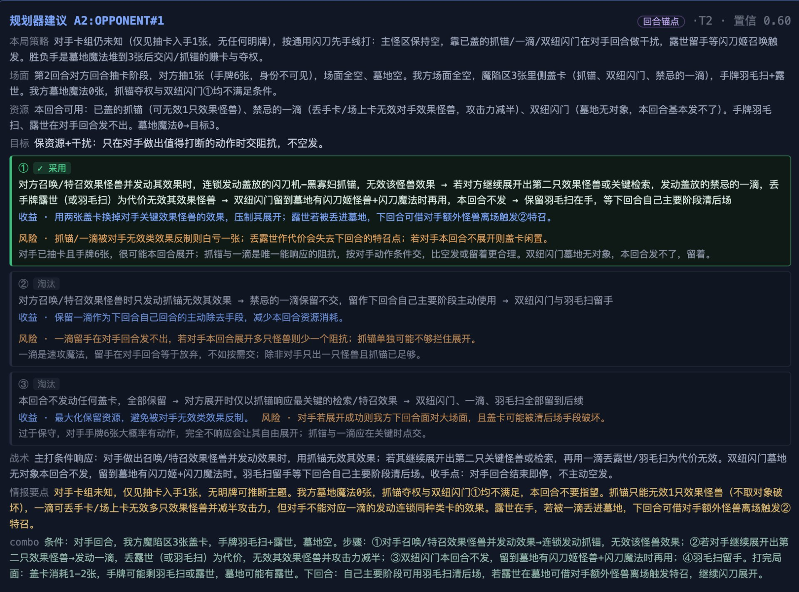
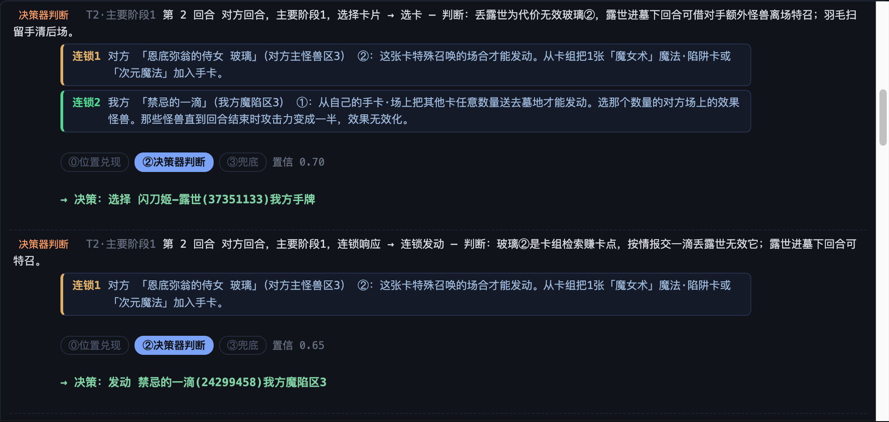
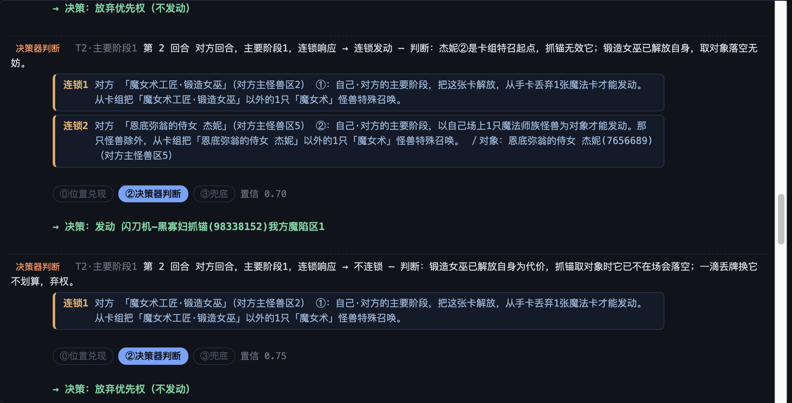

# YGO LLM Agent

**ygo-llm-agent 是一个探索项目：通用 LLM 能把游戏王打到什么程度。**

它不训练模型，也不为任何卡组写死策略——把通用 LLM（任意 OpenAI 兼容端点）接进真实对局环境，
以客户端身份接入 YGOPro 系客户端（如 MDPro3）的房间与真人对打，用实战回答三个问题：

1. **策略能交给模型多少**：回合思路、场面分析、现场取舍，LLM 能承担到什么程度？
2. **代码该兜住什么**：动作校验、算术、各级失败后的自动降级，边界画在哪里？
3. **知识与经验如何补足**：规则、连招、历史对局复盘经 RAG 实时注入——不更新模型参数，
   能否积累出越打越完整的对局能力？

每一步决策都从引擎给出的合法动作里挑选并说明理由，全程可在网页上实时围观。

---

## 目录

1. [功能总览](#1-功能总览)
2. [系统架构](#2-系统架构)
3. [双 Agent 架构：规划器与决策器的协作](#3-双-agent-架构规划器与决策器的协作)
4. [决策流水：fail-closed 的四级应答](#4-决策流水fail-closed-的四级应答)
5. [记忆与记录流](#5-记忆与记录流)
6. [工具与确定性计算](#6-工具与确定性计算)
7. [知识体系：四种知识四种存储](#7-知识体系四种知识四种存储)
8. [Combo 录入与对局复盘](#8-combo-录入与对局复盘)
9. [技术栈](#9-技术栈)
10. [运行](#10-运行)
---

## 1. 功能总览

| 功能 | 说明 |
|---|---|
| 实机对局 | 以客户端身份接入 YGOPro 房间（TCP 7911），上传卡组，自动应答引擎的每一个决策请求 |
| 双 Agent 决策 | 两个 Agent 彼此知晓、双向协作：规划器每回合产出本局策略与写给决策器的现场情报，随每次决策注入决策器上下文；决策器看着真实候选做每手选择，判规划失效可要求规划器重规划；双方共享同一条对局记录流；任何一级失败自动降级，对局绝不卡死 |
| 带记忆的对局 | 各持一份整局持续对话记忆：对局事实逐事件追加入史（永不修剪），战场信息一次性注入用完即弃 |
| Web 实时观战 | 实时看到每次决策：谁做的决定、置信度、理由、没走上一级的原因；建议与决策的因果关系直接可见 |
| Combo 录入 | 你先手打一套连招，AI 自动后手全程配合、到它回合自动认输；每步操作翻成自然语言存入 PostgreSQL |
| 连招参考 | 己方主题的录入自动注入规划器上下文；模型推断出对手卡组后，可按主题/关键卡牌检索参考路线 |
| 对局复盘（对局库） | 对局结束后由 LLM 写结构化复盘，按你选择的入库策略写入知识库，供以后检索历史经验 |
| 知识工具 | 规则书检索、卡面查询、连招检索、对局经验检索与确定性数学工具，模型自主调用；工具报错时错误文本回填、判断不中断 |

---

## 2. 系统架构

```
YGOPro 房间（你建房）
   │ ygopro 协议（TCP 7911）
   ▼
ygopro-sdk ──► 对局状态镜像 + 决策请求（候选集）
   ▼
ygo-play（运行时：连接 → 上传卡组 → 应答循环；CLI 入口）
   ▼
ygo-agent-core（决策核心）
   ├─ 规划器（后台持续 session）：局面盘点 + 回合思路 + 给决策器的情报
   ├─ 决策器（前台）：⓪位置兑现 → ①唯一合法 → ②决策器判断(LLM) → ③兜底
   ├─ 记忆基建：DuelChatMemory（双 Agent 各一份）+ DuelRecordFeed（对局记录流）
   └─ 工具（LLM 自主调用）：search_rulebook / find_card / find_combos / search_duels / 数学工具
   ▼
ygo-play-server（HTTP :8081，同时托管 Web 页面）
   ├─ REST/SSE：启动对局、实时决策流、combo 录入结果查询
   ├─ combo 录入落库 → PostgreSQL combo_record
   ├─ 对局复盘 → LightRAG（按入库策略）
   └─ 知识栈：PostgreSQL（卡面 + 连招）+ Neo4j + LightRAG（规则/对局）
```

| 模块 | 干什么 | 不干什么 |
|---|---|---|
| `ygo-domain` | 纯领域模型（卡牌、区域、状态、请求/应答） | 不依赖任何框架 |
| `ygopro-sdk` | YGOPro 协议编解码、状态镜像、会话门面、决策超时看门狗 | 不做决策 |
| `ygo-duel-log` | 对局事件记录（JSONL）、查询回放 | 不做语义 |
| `ygo-agent-core` | 决策核心：流水、双 Agent、记忆、工具、上下文构建| 无 web、无 DB、不读环境变量 |
| `ygo-play` | 运行时：连房间、上传卡组、应答循环、录入认输守卫；CLI 入口 | 不实现策略 |
| `ygo-play-server` | HTTP/SSE 服务、多局管理、combo 落库、复盘写库、托管前端 | 不碰决策逻辑 |
| `ygo-rag` | LightRAG 入库脚本与提示词资产（唯一非 Java 模块） | 不含服务 |
| `web/` | Svelte 前端（对战观战 + Combo 录入两页） | — |

---

## 3. 双 Agent 架构：规划器与决策器的协作

决策核心由两个各司其职的 LLM Agent 组成。**规划器（代码类名 Planner）**与
**决策器（Executor，代码类名 Judge）**不在同一个对话里、不共享记忆、思考档位不同、
输出契约不同——但**彼此知道对方的存在与职责**：规划器的提示词明确自己"为决策器供情报"
的定位，决策器的提示词里专门有一节讲"规划器情报的用法"。衔接靠三条通道（§3.3）。

### 3.1 三条铁律

1. **候选唯一入口**：AI 只能从引擎枚举的合法动作里选，不允许"自己生成一个动作再去匹配"；
2. **LLM 不做算术**：LP、卡组剩余等计数由状态镜像直接注入；战斗结算、伤害投影、斩杀口径
   由确定性数学工具按需提供（`DuelMathService` 纯函数）——模型只引用计算结果；
3. **每级都能降级**：任何一级失败都落到下一级，最后一定是合法应答，对局不会卡死。

### 3.2 角色分工

| 维度 | 规划器（Planner） | 决策器（Executor） |
|---|---|---|
| 位置 | 后台 worker 线程，持续对话 session | 前台，引擎每发一个选择请求应答一次 |
| 输入 | **多**：整局静态资料（连招参考 + 卡组全清单）+ 完整记录流（详情窗口更大）+ 回合级局面快照 | **少**：精简静态资料 + 同一条记录流（详情窗口更小）+ 当前决策快照；细节缺了靠工具现查 |
| 思考档位 | 深思考档（checkpoint 档），把整条链算到收手点 | 决策档（低思考、硬截止），只回答"这个决策点选哪个候选" |
| 输出契约 | `AdvisorAnswer`：本局策略 / 局面分析 / 资源盘点 / 回合目标 / 候选方案对比 / 战术与收手点 / 给决策器的情报 / combo 走向 / 置信度 | `JudgeAnswer`：从候选白名单里选一个（含落点线索）+ 理由 |
| 调用时机 | 回合切换发锚点请求（每回合一次）；决策器判决规划不可用时触发重规划（每回合一次配额） | 每个决策点，带硬超时 |
| 失败影响 | 没有：决策器照常决策，只是少一份情报 | 不存在卡死：决策流水必有应答（见 §4） |

**分工原则**：规划器为辅助决策器而存在——上下文更多、思考更深；决策器只回答
"这一步现在能不能落、落哪个"。决策器不自己重新规划（规划失效时只能判决并请求重规划），
规划器也不碰候选选择——否则每一级都成了另一个规划器，行为不可预测。

### 3.3 协作机制：三条通道

**① 建议快照（规划器 → 决策器）**

规划器每次产出 `AdvisorAnswer` 后，最新一份由 `AdvisorKeeper` 持有。决策器每次调用时，
快照经截断渲染成 `[规划器情报]` 段注入决策快照：策略摘要、回合目标、战术要点、
情报要点（对手已交的阻抗、威胁时点、关键卡面互动）、combo 走向。快照带发布回合号；
跨回合沿用的建议渲染"（上回合制定，仅供参考）"的陈旧标记。规划器写新建议前能看到
上一份建议的原文（以〔历次建议〕台账行存在记忆里，永不修剪），保证前后一致性。

这份建议在 Web 观战页上就是一张「规划器建议」卡片：头部是建议标识（`A2:OPPONENT#1` =
本局对手回合的第 2 份建议）、触发方式（回合锚点）与置信度；正文是本局策略 / 场面 /
资源盘点 / 回合目标，**候选方案对比**（✓ 高亮采用线，每条带收益、风险与淘汰理由），
最后是战术、情报要点与 combo 条件：



**② 重规划判决（决策器 → 规划器）**

决策器不是规划的机械执行者：每次回答都带一个对当前 `[规划器情报]` 所载规划的判决
（`needReplan` + 判决原因）。判决规划已不可能实现、不合理或已偏离局面时（`needReplan=true`），
决策线程立即触发重规划：旧建议**作废**（发布新建议前，决策器快照不再带 `[规划器情报]` 段），
规划器在后台以决策器给出的原因重新规划（每回合一次配额）。配额用尽或规划器降级时
不再重规划，决策器靠记忆与快照自行判断（fail-closed 语义不变）。

**③ 对局记录流（DuelRecordFeed，共享的事实源）**

每次 LLM 调用前，从对局时间线拉取该 Agent 还没看过的事件增量，以〔决斗记录〕块
**逐事件原文**追加进各自的记忆。要点：

- **记录 = 引擎时间线事件**（客观事实），**决策 = 各自对话里的 AI 回答**——两条线分得很清；
- 记录行是逐事件原文而非回合摘要——摘要聚合是信息损失；纯内存追加零 LLM 成本，
  每个 Agent 独立水位互不推进；
- **战场信息不入记忆、只用一次**：局面、候选、建议这类"过时即失效"的内容走一次性快照槽
  （见 §5），用完即弃。

### 3.4 一手棋的生命周期（协作走读）

以对手回合的一次连锁窗口为例，从引擎请求到应答的完整时序：

```
引擎发出决策请求（连锁响应，候选 C1..Cn）
   ▼
DecisionPipeline.decide(point)
   ├─ planner.observePoint(point)     ← 通知规划器（回合切换触发锚点，每回合一次）
   ▼
⓪ 位置兑现？──命中──► 直接应答（不调 LLM）
   ▼ 未命中
① 唯一合法？──命中──► 规则层秒答（confidence=1.0）
   ▼ 未命中
② 决策器判断：
   ├─ 本回合首次判断且建议未就绪 → 等待规划器锚点（有预算上限，等待不计入决策预算）
   ├─ feed 拉取对局增量 → 追加进决策器记忆
   ├─ stageOnce(决策快照)：[局面]+[规划器情报]+[当前效果]+[候选]+[候选卡面]
   ├─ judgeAgent.decide(决策请求行)   ← 每次决策一次调用，带工具、带硬超时
   ├─ 判决规划已不可用 → needReplan=true：旧建议立即作废，规划器按给出的原因重规划
   ├─ 候选越界 → 用更正消息重答一次（坏答案留在记忆里，模型看得到自己错在哪）
   └─ finally dropEphemeral()          ← 快照用完即弃
   ▼ 失败
③ 兜底：经验规则 / 熟记连招 / 第一个合法候选
   ▼
轨迹落盘 + SSE 推送前端（谁做的决定、置信度、理由、未命中原因）
```

规划器一侧在后台并行：回合切换发锚点请求（记录拉取入史 + 局面快照一次性注入，产出全量
建议）；回合内不再主动修订，唯一的回合内规划是决策器判决触发的重规划。规划器失败只影响
决策器的情报质量，不影响对局进行。

---

## 4. 决策流水：fail-closed 的四级应答

引擎发来决策请求（主阶段动作 / 连锁响应 / 选卡 / 选位置 / 是否发动……）后，按固定顺序尝试：

| 级 | 名称 | 触发条件 | 归因徽标 |
|---|---|---|---|
| ⓪ | 位置兑现 | 决策器在选动作时已一并给出落点 → 直接用于紧随其后的"选位置"请求 | 位置兑现 |
| ① | 唯一合法 | 引擎只给了唯一合法选项，没有判断余地 | 唯一合法 |
| ② | **决策器判断** | 上面都没接住：调一次 LLM，带着候选白名单就地看着选（可调工具） | 决策器判断 |
| ③ | 兜底 | LLM 也失败：熟记连招 / 经验规则 → 第一个合法候选 | 经验规则 / 兜底 |

值得了解的行为：

- **连锁、是否发动、选卡这类请求不会掉到 ③ 的机械保底**：除空候选外一律进 ② 让模型判断；
- 每一步失败都会写 `missReasons`（"为什么没走上一级"），Web 界面和轨迹里直接可读；
- 决策器对模型输出只做"能不能执行"的校验，**不做"该不该这么打"的改判**；
- 任何一级抛出异常都落到 ③；运行时另有协议层看门狗，决策线程卡死时由 SDK 提交保底应答。

实机的决策流长这样——每行是一次决策的完整归因：抬头（回合 / 阶段 / 请求性质）→
**连锁逐环卡片** → **流水徽标**（命中的那级高亮）→ 置信度 → `→ 决策`（最终提交给引擎的动作）：



同一类请求也可能选择不发动——下面的窗口里，决策器先抓住对手特召起点发动了黑寡妇抓锚，
随后判断"锚取对象时自己已落空"而放弃优先权，两次判断各有理由：



每次决策都带"谁做的"徽标（位置兑现 / 唯一合法 / 决策器判断 / 经验规则 / 兜底）。
`answered / fallbacks`（已答 / 保底）两个数字是"这局 AI 到底自己打了多少手"的硬指标。

关键时间预算（完整配置见 `.env.example`）：决策时最多等规划器建议 4s
（`PLANNER_WAIT_DECISION_MS`，0 = 关闭），决策器判断硬超时 10s（`JUDGE_TIMEOUT_MS`），
规划器后台单次调用 45s、连续失败后冷却 60s（冷却期内决策器不等建议直接判断），
协议层看门狗 25s（`DUEL_CHOICE_TIMEOUT_MS`，卡死时 SDK 强制保底应答）。等待建议不占用
决策预算（截止时间整体顺延）。

---

## 5. 记忆与记录流

规划器与决策器各持一份 `DuelChatMemory`（LangChain4j `ChatMemory` 的自定义实现），
条目分三类（分类在内存结构里，不靠消息文本标记）：

| 条目类型 | 内容 | 修剪策略 |
|---|---|---|
| `PINNED` | `[0]` system 提示词、`[1]` 整局静态资料（构造时显式种入） | 永不修剪 |
| `RECORD` | 决斗记录流：〔决斗记录〕逐事件原文块、〔历次建议〕台账行 | **永不修剪、只增不减** |
| `NORMAL` | 决策请求行、AI 回答、工具对 | 受修剪窗口管辖（推理的近期性靠它，事实账本靠 RECORD） |

修剪规则（锯齿）：NORMAL 超过阈值才剪（规划器 24 / 决策器 16 条），剪后保留全部
PINNED + 全部 RECORD + 最近若干条 NORMAL（规划器 12 / 决策器 8）；保留边界向后扩到
`UserMessage` 边界（工具对不从中间劈开），被剪范围里的 RECORD 原位保留。append-only
的追加顺序保证 LLM 服务端的前缀缓存跨回合有效。

**一次性快照槽（ephemeral）**是记忆基建的另一半：调用前 `stageOnce(快照)`，finally 里
`dropEphemeral()`。槽内容全程对本次调用（含工具轮）可见，但**绝不进持久记忆**——
战场信息、候选清单、规划器情报都是"过时即失效"的内容，用过即弃，记忆里只留对局事实。
两个 Agent 不共享记忆实例：system、思考档位、修剪窗口都不同，前缀缓存互不污染。

**决策器的每次调用**（带记忆的持续对话，每手一次结构化调用）：

```
feed.fillBeforeCall(judgeMemory, 当前回合);  // 拉对手/系统增量（入史，按水位去重）
judgeMemory.stageOnce(决策快照);         // 一次性注入（不入史）
answer = judgeAgent.decide(决策请求行);   // 带工具、带硬截止
（候选越界 → judgeAgent.retry(更正行)，坏答案留在记忆里）
finally judgeMemory.dropEphemeral();
```

**决策请求行**（入史）：抬头（回合 / 阶段 / 这一手是什么）→ 连锁行（逐环）→ 候选清单
（`C1 发动 连刀①、C2 放弃优先权`）→ 候选效果条款全文 → 一句指引。**决策快照**（一次性）：
`[局面]`（双方 LP/手牌/场面/墓地 + 内联计数）+ `[规划器情报]` + `[当前效果]`/`[本次请求]`
+ `[候选]`/`[候选卡面]` + `[表示形式决策]`（表攻/表守请求）。候选带语义编号
（「C1 我方主怪兽区1」「C6 发动 交闪 (63166095)」），区域名与资料库用同一套中文说法。

**规划器的每次调用**：锚点（回合切换触发，每回合一次，`===回合锚点===`，对方回合的模板
额外要求先核"这回合哪些牌真的能用"，再问反击窗口与借力窗口）与重规划（`needReplan=true`
触发，`===重规划（决策器要求）===`，判决原因原样转达）。输出只有**全量建议**一种形态；
输出契约的唯一源是 POJO 字段上的注解（框架据此生成格式指令），内容全空 = 未按 schema
输出，不发布建议。

---

## 6. 工具与确定性计算

规划器与决策器都注册了标准 OpenAI function-calling 工具，模型自主决定何时调用：

| 工具 | 参数 | 数据源 | 什么时候该调 |
|---|---|---|---|
| `search_rulebook` | `query`、`top_k?` | LightRAG（规则域） | 不确定规则/裁定/时点，需要精确条文 |
| `find_card` | `query`（卡名或卡号） | PG `card` 表（回退 `cards.jsonl`） | 需要卡面事实（攻守、效果原文），不许凭记忆 |
| `find_combos` | `archetype?`、`card?` | PG `combo_record` | 推断出对手主题、或看到对手典型关键卡时，查"这套卡组通常怎么展开"；一次最多 3 条 |
| `search_duels` | `query`、`top_k?` | LightRAG（对局域） | 觉得"这局面以前见过"，找历史经验 |
| 数学工具 | 场上局面句柄（如 `我方主怪兽区3`）+ `side` 参数 | 状态镜像 + `DuelMathService` 纯函数 | 需要战斗结算、伤害投影与斩杀口径、抽卡概率、素材核对时 |

实现要点：

- 工具回路**最多 6 轮**（`maxToolCallingRoundTrips`）；
- 工具执行异常不会报废整轮：错误文本作为工具结果回填（"工具检索失败：…请基于上下文里
  已有的信息继续判断"），模型带着已有信息继续决策；
- 卡面纪律由提示词约定：回合快照里带有的 [卡面] 以它为准，**没有才调 `find_card`** 查原文
  （同一张卡只查一次），查不到就明说缺资料，绝不凭记忆编效果；
- 确定性计算（战斗结算、伤害投影、斩杀口径）由 `DuelMathService` 纯函数完成——
  "能不能斩杀、该不该打"这类判断仍由模型做，但每个数字都有代码出处。

---

## 7. 知识体系：四种知识四种存储

项目最重要的一条经验：**不同的知识用不同的存储**，不把所有东西都塞进向量库：

| 知识 | 查询形态 | 存储 | 入库方式 |
|---|---|---|---|
| 规则书 | "额外怪兽区能不能放连接怪兽"（自然语言语义） | **LightRAG**（PostgreSQL 存向量 + Neo4j 存实体关系图） | 整本 PDF 上传，LLM 逐块抽取实体关系与向量 |
| 卡牌 | "23434538 是什么卡"（精确主键）/ 名字模糊查 | **PostgreSQL `card` 表**（回退本地 `cards.jsonl`） | 客户端 cards.cdb 转换后 COPY 导入，全程零 LLM |
| 连招 | 己方按主题注入上下文；对手按主题名/关键卡牌名精确捞参考 | **PostgreSQL `combo_record`**（实战录入，唯一连招存储） | Web「Combo 录入」页直接存库 |
| 对局 | "这种局面以前怎么输的"（叙事记忆） | **LightRAG**（LLM 写的复盘） | 对局结束后自动（按入库策略） |

规则和对局共用一个 LightRAG 实例，靠来源前缀隔离（`rule-*.pdf` / `duel:<对局id>`）：
`search_rulebook` 只吃规则域，`search_duels` 只吃对局域，互不污染。**卡面走精确查询、
连招按主题/关键卡精确匹配**——语义检索只用在真正语义化的查询上。

---

## 8. Combo 录入与对局复盘

**Combo 录入**（Web「Combo 录入」页，唯一存储是 PostgreSQL `combo_record`，存库即生效）：
卡组主题必填（它是归档、上下文注入与检索的键）→ AI 自动后手接入、**全程不思考**（不调 LLM）
→ 你先手打 combo，轮到 AI 回合瞬间**自动认输**结束录制 → 服务端把你回合的每步操作
（卡牌移动、效果发动、阶段切换）翻成自然语言，连同 LLM 摘要（固定五段：概述 / 展开 /
终端 / 关键卡牌 / 备注，关键卡牌是检索依据）写入 `combo_record`。LLM 失败时步骤照存；
SSE 断开页面自动轮询兜底。

连招的生效：用己方主题对战时，开局按主题拉最近 10 条（`COMBO_CONTEXT_LIMIT`，1–30）
注入规划器上下文；对手的卡组则由模型推断主题后自主调 `find_combos`（一次最多 3 条）。
主题匹配是双向包含（"闪刀"能匹配"闪刀姬"），关键卡牌按"记录的关键卡牌列包含查询卡名"命中。

**对局复盘**（正常结束后自动生成）：

```
决策轨迹（可读动作+理由） + 对局日志（LP/手牌/回合）
   → 代码整理成素材（连续相同动作折叠、每回合封顶、只陈述不评价）
   → LLM 按固定小节写复盘（结论/走向/关键决策/转折点/失误/下次怎么办/入库判定）
   → 拼上确定性文档头（id/日期/主题/先后手/胜负）→ 写入 LightRAG（duel:<id>）
```

LLM 不可用或输出不合结构时退回模板摘要（只记事实不含判断）。**是否入库由你在前端选择**
（入库策略，每局可改，浏览器记住上次的选择）：**结束后问我**（默认，对局结束弹出询问）/
**模型判定**（LLM 自评"值不值得入库"，判不值得就不写）/ **全部入库** / **全部不入库**。
手动停止与失败的对局不进对局库。复盘入库后，对局中模型通过 `search_duels` 自主检索，
召回时按小节裁剪（保留结论/转折点/失误/下次怎么办，丢流水账）。

---

## 9. 技术栈

| 层 | 技术 | 用在哪 |
|---|---|---|
| 语言/构建 | **Java 25** + Maven 多模块（6 个 Java 模块） | 全部后端与决策核心 |
| LLM 框架 | **LangChain4j 1.23**（AiServices 声明式接口、结构化输出、function calling、自定义 ChatMemory） | 双 Agent、工具回路、复盘/摘要 |
| Web 框架 | **Spring Boot 4.1** | ygo-play-server：REST + SSE、combo/复盘落库、托管前端 |
| 对局协议 | 自研 `ygopro-sdk`（YGOPro TCP 7911 协议编解码、状态镜像、超时看门狗） | 实机对局 |
| 关系存储 | **PostgreSQL 18**（pgvector 镜像） | 卡面 `card` 表、连招 `combo_record` 表、LightRAG 向量存储 |
| 图存储 | **Neo4j 5.26** | LightRAG 抽取的规则/对局实体关系图 |
| RAG 引擎 | **LightRAG**（HKUDS，Python；Docker 部署） | 规则书与对局复盘的语义检索 |
| 前端 | **Svelte 5 + Vite 6 + TypeScript**（pnpm） | 对战观战页、Combo 录入页；构建产物由服务端托管 |
| 实时推送 | SSE（历史整段回放 + 断线轮询兜底） | 决策流、录入进度 |
| LLM 端点 | OpenAI 兼容 API（默认 DeepSeek，模型/思考强度可配） | 决策、规划、摘要、复盘 |
| 部署 | Docker Compose（一条命令起全部） | 知识栈 + 对局服务 |

依赖原则：决策核心（`ygo-agent-core`）是纯 Java 库——不碰 web、不碰数据库、不读环境变量，
一切配置经构造器传入；框架集成只发生在宿主模块（CLI 与 server）。

---

## 10. 运行

前置：Docker Compose（跑知识栈与对局服务）、YGOPro 系客户端（**只跑在宿主机**，负责建房
与结算，AI 以客户端身份连入）、`LLM_API_KEY`（OpenAI 兼容端点，默认 DeepSeek；没有它 AI
只走规则层）、一副 .ydk 卡组（路径或直接粘贴文本）。

```bash
# 1. 配置：cp .env.example .env
#    必改 LLM_API_KEY；建议改 RAG_AUTH_ACCOUNTS / RAG_TOKEN_SECRET / NEO4J_PASSWORD；
#    下规则书才需要 EMBEDDING_API_KEY（LightRAG 入库，默认 bge-m3 / SiliconFlow）

# 2. 一键起全部（首次构建镜像需几分钟）
docker compose up -d
curl localhost:8081/actuator/health      # {"status":"UP"}

# 3. 卡牌入库（决策侧查卡依赖它）
python3 ygo-rag/scripts/build_card_rag.py \
  --mdpro3 "<MDPro3 数据目录>" --ygopro "<YGOPro 数据目录>"   # 生成 data/card_rag/cards.jsonl
make cards-pg                            # COPY 进 PostgreSQL card 表

# 4. 规则书入库（可选，LightRAG 语义检索用）
./ygo-rag/scripts/ingest-rules.sh        # 文件名以 rule- 开头（如 rule-ocg-zh.pdf）
```

开打：YGOPro 建房（默认监听 7911）→ 打开 <http://localhost:8081>「对战」页 →
地址填 `host.docker.internal`、卡组粘贴 .ydk 文本（推荐）、可选卡组主题与打法思路 →
点「接入并对战」。实时决策流会显示每次建议与判断；对局结束后按入库策略处理复盘。

| 端口 | 服务 |
|---|---|
| 8081 | ygo-play-server（REST + SSE + Web 页面） |
| 9621 | LightRAG（WebUI 在 `/webui`） |
| 5432 / 7474 / 7687 | PostgreSQL（卡面+连招+RAG 存储）/ Neo4j（图谱/Bolt） |
| 7911 | YGOPro 客户端（宿主机对局协议） |

本地开发（知识栈仍用 Docker，Java 在本机跑）：`make up-rag` → `make build && make test` →
`make play-server`；或纯 CLI 对局 `make play-p0 YDK=/path/to/卡组.ydk`。CLI 与服务共用
同一套决策核心与配置（读仓库根 `.env`）。HTTP API 一览见 `DuelController`
（启动/SSE 决策流/combo 结果/入库决定/主题列表）。

---

## 许可

[MIT License](LICENSE)
