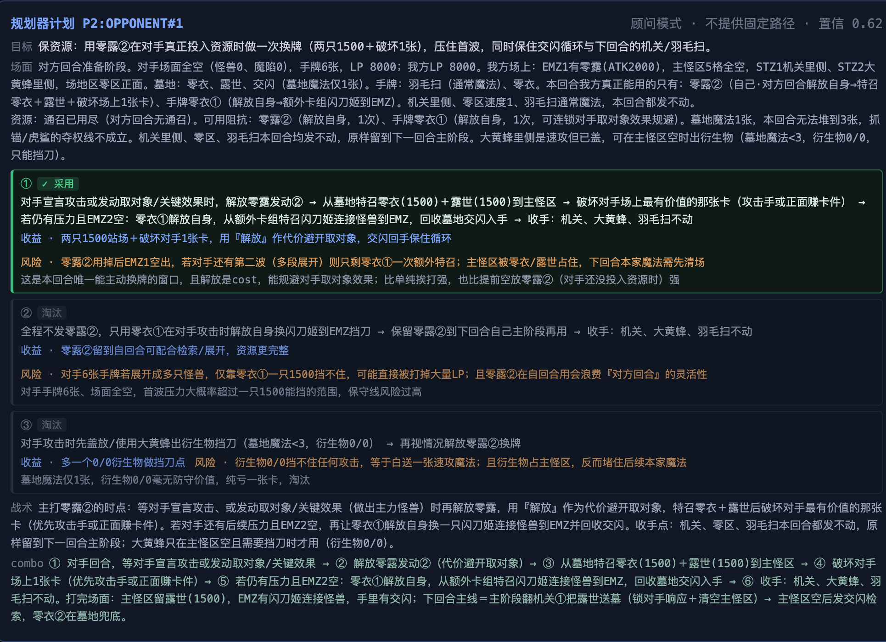
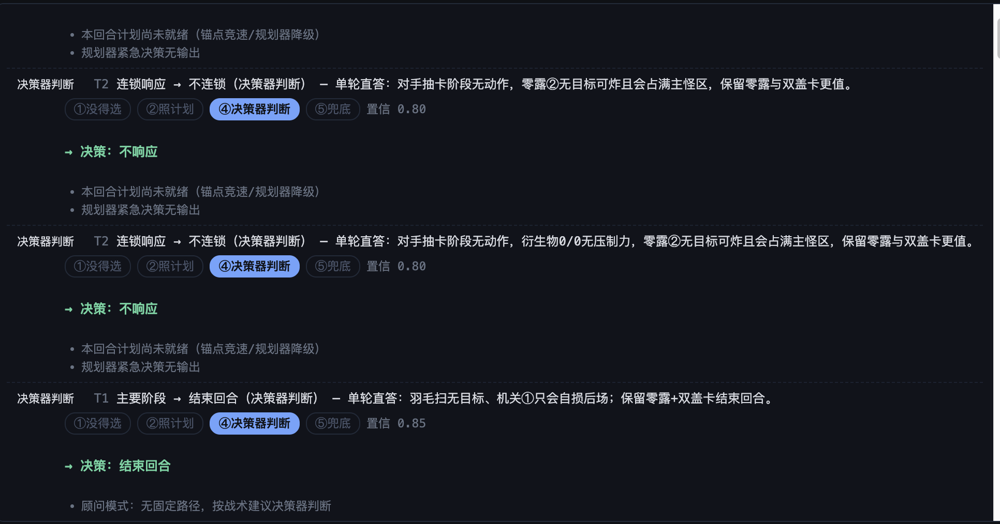

# YGO LLM Agent

---

## 1. 这是什么

**ygo-llm-agent 是一个探索项目：通用 LLM 能把游戏王打到什么程度。**

它不训练模型，也不为任何卡组写死策略——把通用 LLM（任意 OpenAI 兼容端点）接进真实对局环境，
以客户端身份接入 YGOPro 系客户端（如 MDPro3）的房间与真人对打，用实战回答三个问题：

1. **策略能交给模型多少**：回合思路、场面分析、现场取舍，LLM 能承担到什么程度？
2. **代码该兜住什么**：动作校验、算术（伤害、斩杀线、资源数由代码算好注入，模型不做算术）、
   各级失败后的自动降级，边界画在哪里？
3. **知识与经验如何补足**：规则、连招、历史对局复盘经 RAG 实时注入——不更新模型参数，
   能否积累出越打越完整的对局能力？

每一步决策都从引擎给出的合法动作里挑选并说明理由，全程可在网页上实时围观。

| 能力               | 说明                                                                                            |
|-------------------|-------------------------------------------------------------------------------------------------|
| 实机对局           | 接入 YGOPro 房间（TCP 7911），上传卡组，自动应答每一个决策请求                                  |
| 双 Agent 决策      | 后台规划器出回合思路，前台决策器五级流水应答，任何一级失败自动降级，绝不卡死对局                |
| Web 实时观战       | 实时看到每次决策：谁做的决定、置信度、理由、没走上一级的原因                                    |
| **Combo 录入**     | 你先手打一套连招，AI 回合自动认输；每步操作翻成自然语言，连同 LLM 摘要与关键卡牌存入 PostgreSQL |
| 连招参考           | 己方主题的录入自动注入 AI 的对局上下文；模型推断出对手卡组后，可按主题/关键卡牌检索参考路线     |
| 对局复盘（对局库） | 对局结束后由 LLM 写结构化复盘，按你选择的策略决定是否写入知识库，供以后检索历史经验             |

---

## 2. 总体架构

```
YGOPro 房间（你建房）
   │ ygopro 协议（TCP 7911）
   ▼
ygopro-sdk ──► 对局状态镜像 + 决策请求（候选集）
   ▼
ygo-play（运行时：连接 → 上传卡组 → 应答循环；CLI 入口）
   ▼
ygo-agent-core（决策核心）
   ├─ 规划器（后台 session）：场面分析 + 回合思路 + 战术（自然语言）
   ├─ 决策器（前台五级流水）：①唯一合法 → ②照计划 → ③走预案 → ④决策器判断(LLM) → ⑤兜底
   └─ 工具（LLM 自主调用）：search_rulebook / find_card / find_combos / search_duels
   ▼
ygo-play-server（HTTP :8081，同时托管 Web 页面）
   ├─ REST/SSE：启动对局、实时决策流、combo 录入结果查询
   ├─ combo 录入落库 → PostgreSQL combo_record（唯一连招存储）
   ├─ 对局复盘 → LightRAG（按入库策略）
   └─ 知识栈：PostgreSQL（卡面 + 连招）+ Neo4j + LightRAG（规则/对局）
```

| 模块              | 干什么                                                     | 不干什么       |
|-------------------|------------------------------------------------------------|----------------|
| `ygo-domain`       | 纯领域模型（卡牌、区域、状态、请求/应答）                                      | 不依赖任何框架        |
| `ygopro-sdk`       | YGOPro 协议编解码、状态镜像、会话门面                                     | 不做决策           |
| `ygo-duel-log`     | 对局事件记录（JSONL）、查询回放、对局日志解析                                  | 不做语义           |
| `ygo-agent-core`   | 决策核心：五级流水、规划器、工具、上下文构建                                     | 无 web、无 DB     |
| `ygo-play`         | 运行时：连房间、上传卡组、应答循环、录入认输守卫；CLI 入口                            | 不实现策略          |
| `ygo-play-server`  | HTTP/SSE 服务、多局管理、combo 落库、复盘写库、托管前端                        | 不碰决策逻辑         |
| `ygo-rag`          | LightRAG 入库脚本与提示词资产（本仓库唯一非 Java 模块）                        | 不含服务           |
| `web/`             | Svelte 前端（对战观战 + Combo 录入两页）                               | —              |

---

## 3. 使用手册（含实机截图）

> 部署步骤在 §8（Docker Compose 一条命令起全部）；本章先带你看看跑起来之后是什么样。

### 3.1 「对战」页：实时观战

观战页由上方的 **规划器计划卡片**与下方的 **决策流**两部分组成。以下截图来自一局真实的闪刀姬对局（顾问模式，对手回合）。

**规划器计划卡片**——规划器对"这个回合怎么打"的完整思考：



- **头部**：计划 id（`P2:OPPONENT#1` = 本局对手回合的第 2 份计划）、模式标识与置信度；
- **目标 / 场面 / 资源**：对局面的结构化盘点——想达成什么、双方现在各有什么、本回合还动得了哪些资源
  （截图里"本回合真正能用的只有零露②"这类约束判断就在这一段）；
- **候选方案对比**：列 2–3 条候选线， **绿色高亮的是被采用的那条**（① ✓ 采用），每条带「收益 / 风险」与
  淘汰理由——"选 A 而不是 B，因为…"直接可见；
- **战术 / combo**：给决策器参考的战术要点与完整 combo 走向（顾问模式下这些内容会注入后续每次决策的上下文）。

**决策流**——每一行是一次决策的完整归因：



- **标题行**：`请求 → 动作 — 理由`（命中哪一级流水看行首徽标与五级流水条）。截图里「连锁响应 → 不连锁 — 单轮直答：…」
  表示 ④决策器判断采纳了一次独立单轮调用的回答；若理由前缀是「规划器抢答：…」则表示采纳了规划会话在双路竞速里先交上的紧急回答；
- **五级流水**：①没得选 → ②照计划 → ④决策器判断 → ⑤兜底， **高亮的是实际命中的一级**，前面的都算"没接住"
  （顾问模式下 ②③ 天然不命中，截图正是如此）；行尾是本次决策的置信度；
- **→ 决策**：最终提交给引擎的操作（"不响应"、"结束回合"）；
- **未命中原因**：为什么没走上一级——截图里是两类典型：「本回合计划尚未就绪（锚点竞速/规划器降级）」
  「顾问模式：无固定路径，按战术建议决策器判断」。

徽标与理由前缀的完整取值见 §4.5（决策可归因）。

### 3.2 对局结束：入库处理

- **结束后问我**：页面弹出绿色询问框 → 点「写入对局库」后台生成复盘（通常十几秒），
  或「不写入」跳过；
- **模型判定 / 全部入库**：页面直接显示去向说明，写入在后台完成；
- 事后可用 LightRAG WebUI（:9621/webui）浏览已入库的复盘。

### 3.3 「Combo 录入」页

完整流程见 §6.1。补充：

- 结果块显示步数、PG 记录号、主题、摘要与前 8 步预览；没有摘要会明确标注；
- 录入期间按钮禁用并出现「停止」； **任何终态都会解锁**（录入完成 / 对局结束 / 服务端异常 / SSE 断开），
  不会出现"永远灰着"；
- 浏览器记住了上一局的对局 id：刷新页面后回到录入页，会自动恢复显示上一局的结果。

### 3.4 HTTP API

| 方法   | 路径                      | 用途                                                                                                                               |
|-------------------|---------------------------|------------------------------------------------------------------------------------------------------------------------------------|
| POST   | `/api/duels`              | 启动一局。字段：`host/port/name/deckPath\|deckYdk/move/archetype/deckStrategy/comboRecord/archivePolicy(ask\|auto\|always\|never)` |
| GET    | `/api/duels`              | 对局列表                                                                                                                           |
| GET    | `/api/duels/{id}`         | 状态与统计（answered/fallbacks、胜负、`archivePolicy`、`archiveState`）                                                            |
| GET    | `/api/duels/{id}/events`  | SSE 实时决策流（历史会整段回放）                                                                                                   |
| GET    | `/api/duels/{id}/combo`   | 该局的 combo 录入结果（SSE 丢失时的兜底；无记录 404）                                                                              |
| POST   | `/api/duels/{id}/stop`    | 停止（关闭连接、取消任务）                                                                                                         |
| DELETE | `/api/duels/{id}`         | 同 stop                                                                                                                            |
| POST   | `/api/duels/{id}/archive` | 「结束后问我」模式下提交入库决定，body `{"store":true\|false}`                                                                     |
| GET    | `/api/duels/archetypes`   | combo 库已有的卡组主题                                                                                                             |
| GET    | `/actuator/health`        | 探活                                                                                                                               |

`comboRecord: true` 时强制后手（`move` 忽略），并在 AI 回合开始时自动认输。
`archiveState` 取值：`PENDING`（等决定）→ `ACCEPTED` / `DECLINED`；重复提交幂等。

---

## 4. 对战：AI 是怎么打牌的

三条铁律贯穿始终：

1. **候选唯一入口**：AI 只能从引擎枚举的合法动作里选，不允许"自己生成一个动作再去匹配"；
2. **LLM 不做算术**：攻击伤害、斩杀线、资源数、可放置区域由代码算好注入上下文；
3. **每级都能降级**：任何一级失败都落到下一级，最后一定是合法应答，对局不会卡死。

### 4.1 双 Agent 分工

|          | 规划器（Planner）                                     | 决策器（Executor）                                   |
|-------------------|-------------------------------------------------------|------------------------------------------------------|
| 位置     | 后台持续 session                                      | 前台，每个决策点即时应答                             |
| 输入     | 全局视角（锚点包：双方手牌/场面/墓地 + 已知卡面原文） | 局部视角（决策包：当前局面 + 战术方向 + 候选白名单） |
| 产出     | 回合思路、场面分析、战术（自然语言）                  | 每一次"从候选里选一个" + 理由                        |
| 何时工作 | 回合切换、关键事件、每回合最多 6 次 checkpoint        | 引擎每发一个选择请求                                 |
| 失败影响 | 没有：决策器仍有决策器判断与兜底，一局照常打完        | 不存在失败：五级流水必有应答                         |

**分工原则**：规划器给"这条路怎么走"，决策器只回答"这一步现在能不能落"。
决策器不重新规划——否则每一级都成了另一个规划器，行为不可预测。

### 4.2 决策器：五级流水

引擎发来决策请求（主阶段动作 / 连锁响应 / 选卡 / 选位置 / 是否发动……）后，按固定顺序尝试：

| 级 | 名称           | 触发条件                                                       | 界面徽标        |
|-------------------|----------------|----------------------------------------------------------------|-----------------|
| ⓪  | 位置兑现       | 模型在选动作时已一并给出位置 → 直接用于紧随其后的"选位置"请求  | 照计划          |
| ①  | 唯一合法       | 引擎只给了唯一合法选项，没有判断余地                           | 唯一合法        |
| ②  | 照计划         | 规划器的战术方向能对应当前候选（顾问模式：作为方向参考）       | 照计划          |
| ③  | 走预案         | 主线接不上，但某个分支预案能接上                               | 走预案          |
| ④  | **决策器判断** | 上面都没接住：调一次 LLM，带着候选白名单就地看着选（可调工具） | 决策器判断      |
| ⑤  | 兜底           | LLM 也失败：经验规则 → 第一个合法候选                          | 经验规则 / 兜底 |

值得知道的行为：

- **连锁、是否发动、选卡这类请求不会掉到⑤的机械保底**：除空候选外一律进④让模型判断；
- 每一步失败都会写 `missReasons`（"为什么没走上一级"），Web 界面和轨迹里直接可读；
- 决策器对模型输出只做"能不能执行"的校验， **不做"该不该这么打"的改判**——
  模型自述与选择矛盾时照它的选择执行（设计论证见 architecture.md §3.7）。

这些徽标与流水在界面上长什么样，见 [§3.1 的实机截图](#31-对战页实时观战)。

### 4.3 每次决策的上下文

给 LLM 的上下文由代码拼装，段落顺序即优先级：

```
[卡组主题]  ← 前端指定，作为已知事实注入，不让模型猜
[卡组思路]  ← 你手写的打法说明（可选）
[实战连招参考] ← combo 库里本主题最近的真实录入（没选主题或库空则无此段）
[规则速查]  ← 内嵌的通用规则浓缩版；精确条文仍可 search_rulebook 现查
[局面]      ← 双方 LP/手牌/场面/墓地 + 已知卡面原文 + 数学（伤害/斩杀线）
[候选]      ← 本决策点的合法动作白名单（带语义编号 C1..Cn）
```

三个值得了解的设计：

- **决策器判断没有对话历史**：每次都是独立单轮调用（省成本、局面永远只有一份最新）。
  为防模型推翻自己，上下文显式注入 `[本回合已做]`（既成事实 + 上一手判断）；
- **位置不单独问**：模型在给动作的同一次回答里一并给出落点（MMZ-3 等），
  之后遇到"选位置"请求直接兑现，不烧第二次调用；
- **候选编号带语义**：模型看到的是「MMZ-1（我方主怪兽区#1）」「发动 交闪 (63166095)」，
  不是裸下标；卡库查不到的卡明说缺资料，绝不让模型凭记忆编。

### 4.4 时间预算

| 参数                       | 默认  | 含义                                                                |
|-------------------|-------|---------------------------------------------------------------------|
| `PLANNER_WAIT_DECISION_MS` | 4000  | 一次决策最多等规划器多久                                            |
| `PLANNER_FIRST_WAIT_MS` | 7000  | 本回合**首次**决策器判断前等计划的上限                              |
| `PLANNER_WAIT_TURN_MS` | 30000 | 一回合内等待累计上限                                                |
| `ONESHOT_TIMEOUT_MS` | 10000 | 单次决策器判断硬超时（`.env.example` 里写的 5000 是更保守的推荐值） |
| `DUEL_CHOICE_TIMEOUT_MS` | 25000 | 运行时看门狗：决策线程卡死时由 SDK 提交保底应答（0=关闭）           |

### 4.5 决策可归因

每次决策都带"谁做的"徽标（唯一合法 / 照计划 / 决策器判断 / 经验规则 / 兜底）。
`answered / fallbacks`（已答 / 保底）两个数字是"这局 AI 到底自己打了多少手"的硬指标。

---

## 5. 知识与记忆：四种知识四种存储

项目最重要的一条经验： **不同的知识用不同的存储**，不把所有东西都塞进向量库：

| 知识   | 查询形态                                                | 存储                                                    | 入库方式                                              |
|-------------------|---------------------------------------------------------|---------------------------------------------------------|-------------------------------------------------------|
| 规则书 | "额外怪兽区能不能放连接怪兽"（自然语言语义）            | **LightRAG**（PostgreSQL 存向量 + Neo4j 存实体关系图）  | 整本 PDF 上传，LLM 逐块抽取实体关系与向量             |
| 卡牌   | "23434538 是什么卡"（精确主键）/ 名字模糊查             | **PostgreSQL `card` 表**（回退本地 `cards.jsonl`）      | 客户端 cards.cdb 转换后 COPY 导入，不消耗 LLM         |
| 连招   | 己方按主题注入上下文；对手按主题名/关键卡牌名精确捞参考 | **PostgreSQL `combo_record`**（实战录入，唯一连招存储） | Web「Combo 录入」页直接存库（见 §6）                  |
| 对局   | "这种局面以前怎么输的"（叙事记忆）                      | **LightRAG**（LLM 写的复盘）                            | 对局结束后自动（按入库策略）                          |

两类入库的原理与去向：

- **规则书 → LightRAG**：整本 PDF 上传后由 LLM 逐块做实体/关系抽取并向量化，落 PostgreSQL（向量）与
  Neo4j（实体关系图）。文件名即文档来源，规则域必须以 `rule-` 开头（如 `rule-ocg-zh.pdf`），
  检索工具只认这个前缀；上传用 `./ygo-rag/scripts/ingest-rules.sh`，整本约需 10–30 分钟；
- **卡牌 → PostgreSQL `card` 表**：卡面是结构化数据，不需要语义检索——客户端自带的 cards.cdb
  经 `ygo-rag/scripts/build_card_rag.py` 转成 cards.jsonl，再 `make cards-pg` 批量 COPY 进 PG，
  供 `find_card` 按主键/前缀/模糊查询，全程零 LLM 调用。

反面案例供参考：曾给连招做"向量相似度检索"，实测是误导——效果相似的卡并不能替代
combo 里的具体卡，最后回到按主题/关键卡精确匹配。 **语义检索只用在真正语义化的查询上。**

规则和对局共用一个 LightRAG 实例，靠来源前缀隔离（`rule-*.pdf` / `duel:<对局id>`）：
`search_rulebook` 只吃规则域，`search_duels` 只吃对局域，互不污染。

### 5.1 对局复盘（对局库）

对局正常结束（FINISHED）后，服务端生成复盘：

```
决策轨迹（可读动作+理由） + 对局日志（LP/手牌/回合）
   → 代码整理成素材（连续相同动作折叠、每回合封顶、只陈述不评价）
   → LLM 按固定小节写复盘（结论/走向/关键决策/转折点/失误/下次怎么办/关键词/入库判定）
   → 拼上确定性文档头（id/日期/主题/先后手/胜负）→ 写入 LightRAG（duel:<id>）
```

LLM 不可用或输出不合结构时退回模板摘要（只记事实不含判断）。 **是否入库由你在前端选择**（「入库策略」，每局可改，浏览器记住上次的选择）：

| 策略               | 行为                                                               |
|-------------------|--------------------------------------------------------------------|
| 结束后问我（默认） | 对局结束弹出询问；确认写入才生成复盘入库，拒绝则不写               |
| 模型判定           | LLM 写完复盘自评"值不值得入库"：判不值得就不写；LLM 不可用时也不写 |
| 全部入库           | 正常结束即写                                                       |
| 全部不入库         | 什么都不做                                                         |

手动停止与失败的对局不进对局库。复盘入库后，对局中模型通过 `search_duels` 自主检索，
召回时按小节裁剪（保留结论/转折点/失误/下次怎么办，丢流水账）。

---

## 6. Combo 录入与连招库

连招的 **唯一存储是 PostgreSQL `combo_record`**——旧的 JSON 种子/编译流程已删除，
录入存库即生效，没有任何编译步骤。

### 6.1 录入流程（「Combo 录入」页）

**卡组主题必填**：选已有主题或直接输入新名字——它是录入归档、上下文注入与
`find_combos` 检索的键，前端与后端都会拦截空主题（不再有 UNFILED 兜底）。

1. YGOPro 建房 → 页面点「开始录入」→ **AI 自动后手接入，全程不思考**（不调 LLM，
   你回合期间如有连锁询问只做机械兜底应答）；
2. **你先手打你的 combo**；
3. 轮到 AI 回合的瞬间 **自动认输**结束录制；
4. 服务端从对局记录里提取你回合的每步操作——卡牌移动、效果发动、阶段切换， **每步都翻成自然语言**（"召唤/特殊召唤《闪刀机-黑空》到
   怪兽区#2（表侧攻击）"），
   连同 LLM 生成的摘要一起写入 `combo_record`，页面直接显示结果；
5. LLM 摘要固定五段： **概述 / 展开 / 终端 / 关键卡牌 / 备注**。
   关键卡牌（3–6 张核心卡名）是 find_combos 按卡名检索的依据。

容错：LLM 失败时步骤照存（无摘要，`summary_source=NONE`）；PG 不可用时页面明确报错；
SSE 断了页面会自动轮询兜底，刷新页面也能找回上一局的结果。

### 6.2 录入怎么生效

| 场景               | 机制                                                                                                                                 |
|-------------------|--------------------------------------------------------------------------------------------------------------------------------------|
| **用己方主题对战** | 开局时按主题拉**最近 N 条**（`COMBO_CONTEXT_LIMIT`，默认 10，创建时间倒序）注入规划器上下文——"这套卡组实际怎么打"                    |
| **对手的卡组**     | 模型根据对手出现的卡推断出对手主题后，自主调用 `find_combos` 按主题名（或对手的关键卡名）检索参考——"对面通常怎么展开"，一次最多 3 条 |
| **主题下拉**       | 「卡组主题」下拉 = 库里实际存在的主题（`DISTINCT archetype`）；也可以直接输入新名字（录入时必填）                                    |

主题匹配是双向包含（"闪刀" 能匹配 "闪刀姬"），关键卡牌按"记录的关键卡牌列包含查询卡名"命中。

### 6.3 录入质量提示

- 一条录入 = **一次完整展开**。打一半手动停止的对局不会录入；
- 摘要与关键卡牌都出自 LLM， **录入后值得看一眼摘要**——明显跑偏的摘要会污染之后每次检索
  （一条录入删不掉，只能整表清）；
- 效果发动来自协议的连锁消息，"发动了什么"可靠；但对手视角看不到你的手牌，
  起手条件靠摘要的「备注」段记录。

---

## 7. LLM 工具调用一览

决策器（④）与规划器都注册了标准 OpenAI function-calling 工具，模型自主决定何时调用：

| 工具              | 参数                  | 数据源                             | 什么时候该调                                                                    |
|-------------------|-----------------------|------------------------------------|---------------------------------------------------------------------------------|
| `search_rulebook`  | `query`、`top_k?`     | LightRAG（规则域）                 | 不确定规则/裁定/时点，需要精确条文                                              |
| `find_card`        | `query`（卡名或卡号） | PG `card` 表（回退 `cards.jsonl`） | 需要卡面事实（攻守、效果原文），不许凭记忆                                      |
| `find_combos`      | `archetype?`、`card?` | PG `combo_record`                  | 推断出对手主题、或看到对手典型关键卡时，查"这套卡组通常怎么展开"；一次最多 3 条 |
| `search_duels`     | `query`、`top_k?`     | LightRAG（对局域）                 | 觉得"这局面以前见过"，找历史经验                                                |

实现要点：

- 工具回路 **最多 3 轮**，轮次用尽后收掉工具、强制要 JSON 答案；
- 任何工具异常自动降级为普通补全——知识库挂了只是"少一个参考"，决策照常；
- 规划器的上下文会 **预注入**双方已知卡的效果原文（额外卡组/检索目标/对手明牌），
  减少逐张查卡的工具调用；不在预注入范围内的卡要求模型必须先 `find_card`。

---

## 8. 部署：Docker Compose

一条 `docker compose up -d` 起齐知识栈（PostgreSQL + Neo4j + LightRAG）与对局服务（含 Web 页面）。

### 8.1 前置要求

| 需要                      | 说明                                                                 |
|-------------------|----------------------------------------------------------------------|
| Docker + Docker Compose   | 宿主机上跑知识栈与对局服务                                           |
| YGOPro 系客户端（桌面端） | **只跑在宿主机**：负责建房与实际结算；AI 以客户端身份连入            |
| `LLM_API_KEY`      | OpenAI 兼容端点（默认 DeepSeek）；没有它 AI 只走规则层，不会调用模型 |
| `EMBEDDING_API_KEY` | LightRAG 入库用（默认 bge-m3 / SiliconFlow）；不下规则书可以不配     |
| 一副卡组的 .ydk           | 宿主机路径或直接粘贴文本                                             |

### 8.2 部署步骤

```bash
# 1. 配置
cp .env.example .env
#   必改：LLM_API_KEY（决策模型）
#   建议改：RAG_AUTH_ACCOUNTS / RAG_TOKEN_SECRET / NEO4J_PASSWORD（知识栈有 WebUI 与端口暴露）
#   下规则书才需要：EMBEDDING_API_KEY

# 2. 一键起全部（首次会构建镜像，需几分钟下载依赖）
docker compose up -d

# 3. 等服务就绪
curl localhost:8081/actuator/health      # {"status":"UP"}
curl localhost:9621/health               # LightRAG

# 4. 卡牌入库（决策侧查卡依赖它；原理见 §5）
#    客户端 cards.cdb → 转结构化 jsonl → COPY 进 PostgreSQL card 表
#    两个目录分别为 MDPro3 / YGOPro 客户端的数据目录（内含 Data/locales/*/cards.cdb 与 strings.conf），
#    也可用环境变量 MDPRO3_DIR / YGOPRO_DIR
python3 ygo-rag/scripts/build_card_rag.py \
  --mdpro3 "<MDPro3 数据目录>" --ygopro "<YGOPro 数据目录>"   # 生成 data/card_rag/cards.jsonl（15019 张）
make cards-pg                            # 导入 PG card 表
```

`combo_record` 表无需手动建：服务启动时自动建表/补列。

### 8.3 开打

1. **YGOPro 建房**：创建主机（默认监听 7911），等 AI 加入；
2. **打开 Web**：<http://localhost:8081> → 「对战」页：
    - 地址填 `host.docker.internal`（容器内访问宿主机的 YGOPro 客户端；端口 7911）；
    - 卡组：填宿主机路径时先在 compose 里放开 `/path/to/decks:/decks:ro` 挂载并写 `/decks/xxx.ydk`，
      或直接在「高级」里粘贴 .ydk 文本（推荐，无挂载依赖）；
    - 卡组主题：选 combo 库已有主题（有录入就会注入上下文），或留空；
    - 入库策略：按 §5.1 的表选；
    - 卡组思路（可选）：写给 AI 的打法说明，注入每次决策的上下文，与通用战术冲突时以它为准；
    - 点「接入并对战」。
3. 实时决策流会出现每次规划与决策；对局结束后按入库策略处理复盘。

### 8.4 端口与数据一览

| 端口        | 服务                    | 说明                                                                               |
|-------------------|-------------------------|------------------------------------------------------------------------------------|
| 8081        | ygo-play-server         | REST + SSE + **Web 页面**（前端构建产物由服务端托管）                              |
| 9621        | LightRAG                | REST API；WebUI 在 <http://localhost:9621/webui>（登录账号见 `RAG_AUTH_ACCOUNTS`） |
| 5432        | PostgreSQL              | `ygo` 库 = 卡面 + 连招表；`ygo_rag` 库 = LightRAG 存储                             |
| 7474 / 7687 | Neo4j                   | 图谱浏览 / Bolt                                                                    |
| 7911        | YGOPro 客户端（宿主机） | 对局协议，AI 作为客户端连入                                                        |

| 数据             | 位置                                                        | 说明                          |
|-------------------|-------------------------------------------------------------|-------------------------------|
| 决策轨迹         | 卷 `tracedata`（容器 `/tmp/ygo-trace/*.jsonl`）             | 每局一个文件，复盘素材        |
| 对局日志         | 卷 `duellogdata`（容器 `/tmp/ygo-duel-log/*.jsonl`）        | 协议事件 + 录入素材           |
| 服务日志         | `./logs/`（宿主机）                                         | 按天滚动，留 14 天            |
| combo / 卡面数据 | `combo_record` 表在卷 `pgdata`；卡面兜底 jsonl 在 `./data/` | 录入直接写库                  |
| 知识栈数据       | 卷 `pgdata` / `neo4jdata` / `lightragdata`                  | `make reset` 清空（含轨迹卷） |

---

## 9. 本地部署（不用 Docker 跑 Java）

知识栈仍然用 Docker，只有 Java 服务与前端在本地跑（开发调试常用）：

```bash
export JAVA_HOME=$(/usr/libexec/java_home -v 25)  # 需要 JDK 25

# 1. 知识栈
make up-rag                 # postgres + neo4j + lightrag

# 2. 构建 + 测试
make build                  # 或 ./mvnw -DskipTests install
make test

# 3. 卡牌入库（同 7.2 第 4 步）

# 4. 对局服务（:8081，同时托管 web/dist 静态页）
make play-server

# 5. 前端改动时单独构建（产物进 web/dist，服务端直接托管，刷新即生效）
cd web && npm run build

# 6. 或者不用服务，直接 CLI 对局
make play-p0 YDK=/path/to/闪刀.ydk
#    YDK 必填；可覆盖：HOST / PORT / NAME / MOVE（first|second）
#    卡组思路走环境变量：DECK_STRATEGY="…" 或 DECK_STRATEGY_FILE=策略.md
```

CLI 与服务共用同一套决策核心与配置（读仓库根 `.env`）。

---

## 10. 配置项参考

全部环境变量可在仓库根 `.env` 配置（`cp .env.example .env`），compose 会把它传进容器。
标注 **CLI** 的只在命令行对局时生效。

### LLM 与双 Agent

| 键                                                 | 默认                       | 说明                                                                                     |
|-------------------|----------------------------|------------------------------------------------------------------------------------------|
| `LLM_API_KEY`      | 空                         | **总开关**：非空即启用规划器与决策器判断；空 = 纯规则层                                  |
| `LLM_BASE_URL`     | `https://api.deepseek.com` | OpenAI 兼容端点                                                                          |
| `LLM_MODEL`        | `deepseek-chat`            | 决策与复盘默认模型                                                                       |
| `PLANNER_MODEL`    | 同 `LLM_MODEL`             | 规划器**与决策器判断**共用的模型                                                         |
| `PLAN_EXEC_ENABLED` | 随 key                     | `false` 强制关闭 LLM（双 Agent 整体关闭，只走 ①⑤）                                       |
| `PLANNER_PATH_PLANNING` | `false`                    | 规划器是否产出可执行路径；默认顾问模式（只给场面分析/战术）                              |
| `PLANNER_RUSH_ANSWER` | `true`                     | ④升级竞速里规划器抢答的开关（关闭后升级只跑单轮直答）                                                     |
| `LLM_REASONING_PLANNER` / `LLM_REASONING_DECISION` | 空                         | 思考强度 `off/low/medium/high`；未配置=规划 checkpoint 统一 `low`（推理档）、`off`=快档；决策默认 `off`  |

### 连招库

| 键                    | 默认           | 说明                                                               |
|-------------------|----------------|--------------------------------------------------------------------|
| `COMBO_CONTEXT_LIMIT` | `10`           | 己方主题注入规划器上下文的录入条数上限（1–30，创建时间倒序取最近） |
| `COMBO_SUMMARY_MODEL` | 同 `LLM_MODEL` | 录入摘要可用独立（更便宜的）模型                                   |

（`find_combos` 单次返回 3 条是代码常量，不占配置。）

### 等待与超时

| 键                             | 默认   | 说明                                                          |
|-------------------|--------|---------------------------------------------------------------|
| `PLANNER_WAIT_DECISION_MS` | 4000   | 一次决策最多等规划器多久                                      |
| `PLANNER_FIRST_WAIT_MS` | 7000   | 本回合首次决策器判断前等计划的上限                            |
| `PLANNER_WAIT_TURN_MS` | 30000  | 一回合内等待累计上限                                          |
| `PLANNER_MAX_CHECKPOINTS` | 6      | 每回合后台 checkpoint 次数上限（成本闸）                      |
| `PLANNER_SIMILARITY_THRESHOLD` | 0.80   | 分支相似匹配阈值                                              |
| `ONESHOT_TIMEOUT_MS` | 10000  | 决策器判断硬超时（`.env.example` 给的 5000 是更保守的实用值） |
| `DUEL_CHOICE_TIMEOUT_MS` | 25000  | 看门狗：决策卡死时 SDK 强制保底应答（0=关闭）                 |
| `DUEL_START_WAIT_MS` | 180000 | 等对手进房上限                                                |

### 知识栈

| 键                                                                               | 默认                             | 说明                                                                       |
|-------------------|----------------------------------|----------------------------------------------------------------------------|
| `LIGHTRAG_URL`     | `http://localhost:9621`          | 规则与对局检索（compose 已指向 `http://lightrag:9621`）                    |
| `LIGHTRAG_API_KEY` | 空                               | LightRAG REST 鉴权（设置了就要带 `X-API-Key`）                             |
| `POSTGRES_URL` / `POSTGRES_USER` / `POSTGRES_PASSWORD` | `localhost:5432/ygo` / ygo / ygo | 卡面 + 连招表（compose 已指向容器内 postgres）                             |
| `CARD_RAG_PATH`    | `data/card_rag/cards.jsonl`      | PG 不可用时的卡面兜底文件                                                  |
| `EMBEDDING_MODEL` / `EMBEDDING_DIM` / `EMBEDDING_BASE_URL` / `EMBEDDING_API_KEY` | bge-m3 / 1024 / SiliconFlow / 空 | LightRAG 向量化；**换模型/维度必须清库重建**（`ygo-rag/scripts/reset.sh`） |
| `RAG_AUTH_ACCOUNTS` / `RAG_TOKEN_SECRET` | `ygo:changeme` / —               | LightRAG WebUI 登录与 JWT 密钥（公网暴露务必改）                           |
| `NEO4J_PASSWORD`   | `change-me`                      | Neo4j 密码                                                                 |

### 赛后复盘（对局库）

| 键                                                    | 默认           | 说明                                           |
|-------------------|----------------|------------------------------------------------|
| `DUEL_SUMMARY_ENABLED` | `true`         | 复盘总开关；`false` 时连「结束后问我」也不挂起 |
| `DUEL_SUMMARY_MODE` | `llm`          | `llm` 模型写复盘；`template` 不调模型只记事实  |
| `DUEL_SUMMARY_MODEL` | 同 `LLM_MODEL` | 复盘可用独立模型                               |
| `DUEL_SUMMARY_TIMEOUT_MS` / `DUEL_SUMMARY_MAX_TOKENS` | 60000 / 2000   | 复盘超时与输出上限                             |
| `DUEL_NARRATIVE_MAX_CHARS` | 8000           | 逐回合素材喂给模型的字符预算                   |

是否入库由每局的 `archivePolicy` 决定（见 §3.4）， **不在环境变量里配**。

### 日志与服务

| 键                                             | 默认                   | 说明                                                                  |
|-------------------|------------------------|-----------------------------------------------------------------------|
| `YGO_VERBOSE_LOG`  | `false`                | 全链路日志：LLM 请求/响应原文、工具调用、决策流水（排查必备，见 §11） |
| `YGO_VERBOSE_MAX_CHARS` | 0                      | 单条日志内容上限；0=不截断                                            |
| `YGO_LOG_DIR`      | 自动定位仓库根 `logs/` | 日志目录                                                              |
| `PLAY_SERVER_PORT` | 8081                   | 服务端口                                                              |
| `ygo.play.max-concurrent-duels` | 1                      | 同时进行的对局数（`application.yaml`）                                |
| `BATTLE_REPORT` **CLI**` | 空                     | `1`=实况战场播报写 `/tmp/ygo-live/battlefield.log`                    |
| `DECK_STRATEGY` / `DECK_STRATEGY_FILE` **CLI**` | 空                     | CLI 通道的卡组思路（文件优先）                                        |
| `DUEL_RAW_FRAMES` **CLI**` | 空                     | `1`=原始协议帧写进对局记录（排查解码，体积大）                        |

---

## 11. 可观测性与排查

四个层次，都不依赖 LLM：

| 载体                    | 内容                                                       | 用途                           |
|-------------------|------------------------------------------------------------|--------------------------------|
| SSE 决策流              | Web 页面实时滚动                                           | 边打边看                       |
| decision trace（JSONL） | 每次决策：来源、置信、理由、missReasons、提交摘要          | 复盘"谁做的决定"               |
| duel log（JSONL）       | 协议事件 + 决策上下文 + 效果发动（EFFECT_ACTIVATED）       | 字段级排查、录入素材、回放     |
| 全链路日志              | `YGO_VERBOSE_LOG=true` 时：LLM 请求/响应原文（含工具调用） | 看模型到底被喂了什么、答了什么 |

日志位置：`logs/ygo-play-server.log`（当前）与 `logs/archive/`（按天+100MB 滚动，留 14 天）。

**常见问题**：

| 现象                            | 原因与处理                                                                                                    |
|-------------------|---------------------------------------------------------------------------------------------------------------|
| Web 打不开                      | `curl localhost:8081/actuator/health`；容器没起完 `docker compose ps` 看状态                                  |
| 点「接入并对战」没反应/连不上   | YGOPro 房间没开或端口不对；compose 部署时地址必须是 `host.docker.internal`                                    |
| 报"已有对局进行中"              | 并发上限 1：上一局没结束（去列表里 stop），或旧版本服务残留僵尸对局（重启服务）                               |
| 决策全是「兜底」徽标            | 没有 `LLM_API_KEY`，或 `PLAN_EXEC_ENABLED=false`；看开局日志有无"卡牌事实：PG/回退"与 LLM 装配信息            |
| 决策理由里出现"卡库无资料"      | 卡面数据没入库：跑 `build_card_rag.py` + `make cards-pg`                                                      |
| 录入完没摘要                    | `LLM_API_KEY` 没配或摘要超时；步骤照存，之后每条录入都只描述不含判断                                          |
| `find_combos` 查不到某个主题/卡` | 库里没有该主题或没有含该关键卡的录入；确认录入时主题没写错、摘要生成成功（`summary_source=LLM` 才有关键卡牌） |
| 录入页面卡住不动                | 现版本任何终态都会解锁 + 4 秒轮询兜底；若仍卡死请硬刷新（Cmd/Ctrl+Shift+R）拿最新前端                         |
| 复盘没写进知识库                | 查三点：`DUEL_SUMMARY_ENABLED`、该局 `archivePolicy`、是否正常结束（停止/失败不入库）                         |
| 换了 embedding 模型后检索报错   | 向量维度不一致，必须 `ygo-rag/scripts/reset.sh` 清库重建后重新入库                                            |
| 想看模型被喂了什么              | `YGO_VERBOSE_LOG=true` 重启，日志里按调用 id（#N）串起请求/工具轮/响应                                        |

---

## 12. 已知局限

诚实记录当前没做好的（完整清单见 architecture.md §11）：

1. 选目标类请求没有目标侧校验，模型把破坏/无效目标选到我方卡时只靠提示词约束；
2. LightRAG 抽取用默认英文提示词，中文规则书的同一概念可能裂成多个实体；
3. 连招库覆盖率取决于你录入了几套——没录入的主题既不会注入上下文也查不到；
4. 录入的"效果发动"来自协议连锁消息，未入链的强制效果与暗过程不可见，摘要是感知受限下的归纳；
5. 复盘质量取决于轨迹/日志素材完整度，素材缺失时退回模板摘要。

---

## 目录

1. [这是什么](#1-这是什么)
2. [总体架构](#2-总体架构)
3. [使用手册（含实机截图）](#3-使用手册含实机截图)
4. [对战：AI 是怎么打牌的](#4-对战ai-是怎么打牌的)
5. [知识与记忆：四种知识四种存储](#5-知识与记忆四种知识四种存储)
6. [Combo 录入与连招库](#6-combo-录入与连招库)
7. [LLM 工具调用一览](#7-llm-工具调用一览)
8. [部署：Docker Compose](#8-部署docker-compose)
9. [本地部署（不用 Docker 跑 Java）](#9-本地部署不用-docker-跑-java)
10. [配置项参考](#10-配置项参考)
11. [可观测性与排查](#11-可观测性与排查)
12. [已知局限](#12-已知局限)

---

